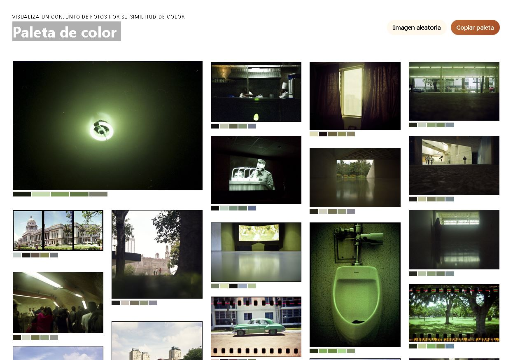

## Extracción de datos de color con Color thief

[Color thief](https://lokeshdhakar.com/projects/color-thief/) es un modulo de python que permite extraer la paleta de color de una imagen, es decir, los colores predominantes en la imagen. Para obtener la paleta de color de una colección digital, primero se debe descargar las imágenes de la colección y luego ejecutar el script de Color thief para obtener los colores predominantes en cada imagen. Los resultados se pueden guardar en un archivo CSV o JSON para su posterior implementación o análisis.

<!--more-->

## Resultado

Con ello cree esta [página](https://gustavolsj.github.io/paleta_color/color_distribution.html)

## Funcionamiento

- [Ver todas las aplicaciones](/aplicaciones/)
